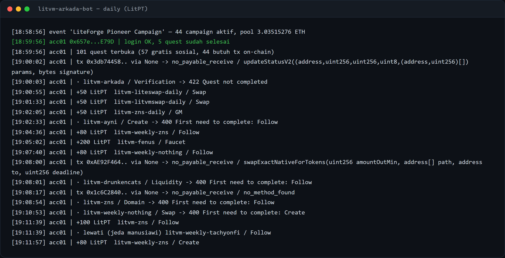
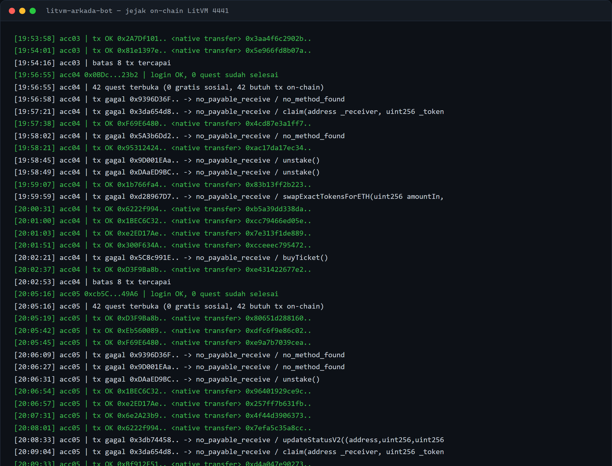

# litvm-arkada-bot

Bot farmer **LitVM — LiteForge Pioneer Campaign** (platform [Arkada.gg](https://app.arkada.gg/en/quest-campaign/litvm)).
Mengumpulkan **LitPT Points** tiap hari dari quest sosial, plus modul on-chain untuk quest
yang mensyaratkan transaksi di LitVM Testnet (chain 4441).

Status riset: 13 Nov 2026 — campaign aktif, pool reward 3.03 ETH, total 22.8 juta LitPT beredar,
40 campaign terbuka. LitVM = L2 EVM di atas Litecoin (Arbitrum Nitro stack), didukung Litecoin
Foundation, mainnet "imminent". 51% supply dialokasikan untuk komunitas (belum ada TGE/token resmi).

---

## Fitur

| Fitur | Keterangan |
|---|---|
| Login otomatis | Tanda tangan pesan statis (EIP-191) → JWT, tanpa captcha/email/OTP |
| Multi-wallet | 1 wallet = 1 akun, wallet dibuat lokal (`--gen N`) |
| Quest harian | 3 quest harian × 50 LitPT = **150 LitPT/hari** tanpa tx on-chain |
| Quest sosial | 57 quest sosial (follow/join/retweet/visit) selesai lewat `check-quest` |
| Modul on-chain | 44 quest bergerbang tx: pelajari method kontrak dari explorer, kirim tx zkLTC |
| Humanisasi | gap antar-quest, urutan acak, skip manusiawi, jeda akun, jitter cron |
| Rate-limit aware | Menghormati `429 Rate limit: try again in 10s` milik server |
| Laporan | `data/last-run.json` + `data/last-run.txt` (log apa adanya) |

## Screenshot

Hasil run asli (bukan mockup) — kartu dibuat dari file log bot sendiri:

**Rutin harian — poin LitPT**



**Jejak on-chain (LitVM LiteForge, chain 4441)**



Alamat wallet disamarkan (`0x1234...abcd`) di kartu publik. Versi alamat penuh ada di
`docs/screenshots/private/` (hanya ada di repo privat, tidak di-commit ke repo publik).


## Kebutuhan

| Item | Detail |
|---|---|
| OS | Windows 10/11 (juga jalan di Linux/macOS) |
| Python | 3.11+ (sudah ada `eth_account` & `requests`) |
| Dependency | `requests`, `eth-account`, `eth-utils` |
| Modal | **Rp 0** untuk jalur sosial. Jalur on-chain butuh zkLTC dari faucet (gratis, tapi faucet ber-challenge) |
| Proxy | Opsional, belum dipakai default (1 IP untuk semua akun = risiko) |

## Setup

```bat
pip install -r requirements.txt
python -m src.main --gen 3
```

Wallet tersimpan di `data/accounts.json` (sudah masuk `.gitignore`, jangan pernah di-commit).

Isi `config.json`:

```json
{
  "chain_id": 4441,
  "ref_code": "KODE_REFERRAL_KAMU",
  "humanize": { "min_gap_sec": 14, "max_gap_sec": 55, "skip_chance": 0.1 }
}
```

`ref_code` diisi kalau wallet baru mau didaftarkan di bawah referral kamu.

## Cara pakai

```bat
JALANKAN.bat              :: menu interaktif (pilih 1-5)
python -m src.main --daily           :: rutin harian
python -m src.main --status          :: cek poin & jumlah quest selesai
python -m src.main --list-onchain    :: daftar quest yang butuh tx on-chain
python -m src.main --daily --onchain :: ikut juga quest on-chain (butuh saldo zkLTC)
```

Opsi tambahan:

- `--accounts acc01,acc02` — jalankan sebagian akun saja
- `--max-quests 5` — batasi jumlah quest per akun (buat tes)
- `--dry` — jangan kirim tx on-chain, cuma tampilkan rencana
- `--no-jitter` — matikan jitter awal (khusus testing)

### Mode jejak testnet (tanpa poin)

Kalau tujuanmu cuma membangun riwayat on-chain di LitVM (bukan mengejar LitPT), pakai:

```bat
python -m src.main --daily --onchain-only --tx-only --max-tx 8 --accounts acc02,acc03
```

`--onchain-only` → hanya quest bergerbang transaksi; `--tx-only` → kirim tx saja tanpa
`check-quest`; `--max-tx N` → batasi N transaksi per wallet. Bot menyaring kontrak yang
tidak menerima transfer biasa lewat `eth_estimateGas` (gratis) sehingga tidak membuang gas.

Hasil terukur: 18 dari 44 kontrak menerima transfer 0.0001 zkLTC; sisanya butuh fungsi
spesifik (`swapExactTokensForETH`, `burn()`, `create(...)`, `updateStatusV2(...)`) dan
dilewati tanpa tx.

## Cara kerja

```
--gen N        →  wallet lokal (eth_account) → data/accounts.json
--daily        →  per akun:
                  1. sign pesan statis → POST /auth/signup → JWT
                  2. GET /internal-project-events/litvm → daftar 40 campaign
                  3. GET /campaigns/{slug} → quest + aturan verifikasi
                  4. urutkan (harian dulu) + shuffle + skip manusiawi
                  5. POST /quests/check-quest {id} → 201 isCompleted=true
                  6. jeda 14-55 detik antar quest (server sendiri minta 10 detik)
                  7. GET /user → poin akhir
```

### Kenapa quest sosial bisa selesai tanpa benar-benar follow/join?

Quest bertipe `twitter` di Arkada tidak punya blok `value.checks`. Server hanya mencatat
`check-quest`, tidak memverifikasi akun X/Discord. Quest bertipe `link` punya `checks`:
backend memanggil Blockscout explorer LitVM dan menjalankan ekspresi JS yang menuntut
**tx sukses dari wallet ke kontrak tertentu**. Itulah bedanya quest gratis vs quest on-chain.

## Batasan yang perlu diketahui

1. **Poin tidak langsung masuk `points-history`.** Quest tercatat `completed`
   (`/quests/completions/user/{addr}`) tapi `points-history` masih 0 sampai campaign
   dianggap selesai/di-finalisasi Arkada. Ini perilaku platform, bukan bug bot.
2. **44 quest butuh tx on-chain.** Kontraknya beda-beda dan hanya menerima method spesifik
   (`stake()`, `approve()`, `swap()`, dst). Modul on-chain mempelajari method dari tx
   pengguna lain di explorer, tapi kalau kontrak menolak transfer biasa, tx revert dan
   quest tetap 422.
3. **Faucet resmi = `faucet.testnet.liteforge.zeeve.net`** (bukan hub Caldera).
   Hub Caldera (`liteforge.hub.caldera.xyz`) sudah rusak: tombol Request-nya membalas
   `could not detect network (NETWORK_ERROR)` karena backend-nya masih memakai RPC lama
   `liteforge.rpc.caldera.xyz` yang sekarang mati (403). Faucet Zeeve jalan: 0.05 zkLTC
   per wallet per 24 jam, proteksi reCAPTCHA v3 yang lolos di Chrome headful.
   Endpoint-nya `POST /api/sendToken {address, token}` — `token` adalah blob terenkripsi
   yang membawa hasil reCAPTCHA, jadi tetap harus lewat browser.
4. **Quest bersifat berurutan.** Quest on-chain dijawab `400 First need to complete: Follow`
   kalau quest sosial di campaign yang sama belum selesai. Bot mengerjakan sosial dulu,
   lalu mengulang yang tertunda di pass kedua.
4. **Rate limit 10 detik per wallet per aksi.** Bot memakai 14-55 detik.

## Humanisasi (bagian dari deliverable, bukan opsional)

| Primitif | Fungsi |
|---|---|
| `run_jitter()` | cron 08:00 tidak jalan tepat 08:00:00 |
| `account_stagger()` | jeda 60-240 detik antar akun |
| `quest_gap()` | 14-55 detik, kadang molor jadi "kelamaan mikir" |
| `quest_order()` | urutan diacak tiap run, quest harian tetap didahulukan |
| `should_skip()` | 10% quest non-harian sengaja dilewat |
| `weekday_bias()` | akhir pekan agak santai (sebagian backlog tidak dikerjakan) |
| `page_dwell()` | jeda baca halaman sebelum submit |
| UA acak per akun | 3 varian Chrome Windows, dipilih per akun |

Yang **tidak** boleh diubah pembeli: gap di bawah 10 detik (server akan menolak) dan
1 wallet dipakai untuk 2 akun (alamat wallet adalah alamat pembayaran airdrop).

## Endpoint yang dipakai

| Method | Path | Fungsi |
|---|---|---|
| POST | `/auth/signup` | `{address, signature, chainId, refCode?}` → JWT |
| GET | `/internal-project-events/litvm` | daftar lokasi + 40 campaign + pool |
| GET | `/campaigns/{slug}` | detail campaign + `quests[]` + `value.checks[]` |
| GET | `/quests/completions/user/{address}` | quest yang sudah selesai |
| GET | `/campaigns/status?campaignIds=..&userAddress=..` | status per campaign |
| POST | `/quests/check-quest` | `{id}` → verifikasi + selesaikan quest |
| GET | `/user` | poin, referral, skor |
| GET | `/internal-project-events/litvm/leaderboard` | leaderboard + multiplier |

RPC: `https://rpc.testnet.liteforge.zeeve.net` (chainId 4441, simbol zkLTC)
Explorer: `https://explorer.testnet.liteforge.zeeve.net` (Blockscout)

## Troubleshooting

| Gejala | Penyebab & solusi |
|---|---|
| `429 Rate limit: try again in 10s` | bot otomatis tunggu 12 detik lalu retry 1×; kalau tetap, jalankan lagi nanti |
| `422 Quest not completed` | quest butuh tx on-chain ke kontrak, saldo zkLTC 0 |
| `401 Unauthorized` | JWT kedaluwarsa (~7 hari) — jalankan ulang, bot login sendiri |
| `login gagal: 400` | signature/chainId tidak cocok; pakai chainId 4441 |
| Poin 0 padahal quest selesai | normal, lihat bagian Batasan poin |
| Faucet 429 challenge | klaim manual di Chrome, bot tidak bisa lewat |

## Struktur

```
litvm-arkada-bot/
├── config.json            (jangan di-commit)
├── config.json.example
├── JALANKAN.bat           menu interaktif
├── CEK-POIN.bat           cek poin cepat
├── requirements.txt
├── src/
│   ├── api.py             klien Arkada + mapper quest
│   ├── humanize.py        lapisan humanisasi
│   ├── onchain.py         kirim tx LitVM + pelajari method kontrak
│   └── main.py            runner CLI
└── data/
    ├── accounts.json      (jangan di-commit)
    ├── last-run.json
    └── last-run.txt
```

## Catatan hasil uji (13 Nov 2026)

```
event 'LiteForge Pioneer Campaign' — 44 campaign aktif, pool 3.03489729 ETH
acc01 0x657e...E79D | login OK, 0 quest sudah selesai
acc01 | 101 quest terbuka (57 gratis sosial, 44 butuh tx on-chain)
acc01 | +50 LitPT  litvm-liteswap-daily / Swap
acc01 | +50 LitPT  litvm-litvmswap-daily / Swap
acc01 | +50 LitPT  litvm-zns-daily / GM
ringkas: 3 quest selesai, 0 dilewati, 44 masih butuh on-chain
```

### Bukti jalur on-chain (13 Nov 2026, acc01 0x657e...E79D)

Faucet Zeeve → 0.05 zkLTC masuk on-chain (saldo terbaca di RPC).

Enam transfer 0.0001 zkLTC ke kontrak yang dituju quest berhasil (`status 0x1`):
`litvm-litstake`, `litvm-litdex`, `litvm-wheelx`, `litvm-weekly-nothing`,
`litvm-weekly-magnetar`, `litvm-farosbeacon`. Dua kontrak (`litvm-athes`, `litvm-forged`)
menolak transfer biasa → revert, gas hangus ~0.00004 zkLTC.

Hasil `check-quest` setelah tx:
```
litvm-litstake   Stake -> 201 completed (200 LitPT)
litvm-wheelx     Swap  -> 201 completed (10 LitPT)
litvm-litdex     Swap  -> 400 First need to complete: Follow
litvm-weekly-*   ...   -> 400 First need to complete: Follow
litvm-farosbeacon Play -> 400 Cant check challenge quest
```

Artinya: verifikasi on-chain Arkada **menerima** transfer biasa ke kontrak, dan quest
sosial harus selesai lebih dulu (berurutan). 18 dari 44 kontrak menerima transfer biasa;
26 sisanya butuh pemanggilan fungsi spesifik (swap/mint/approve) — bot menandainya
`no_payable_receive` tanpa membuang gas.

Dipakai untuk komunitas Layer Airdrop ID — riset & otomasi, bukan jual jasa claim.

---

Dokumentasi endpoint lengkap: `~/HERMES DATA/airdrop-tracker/knowledge-graph/data/litvm-arkada-endpoints.md`
